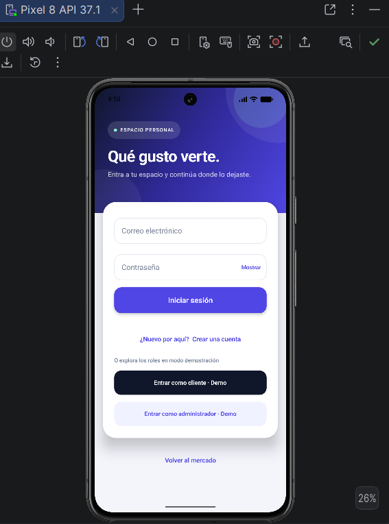
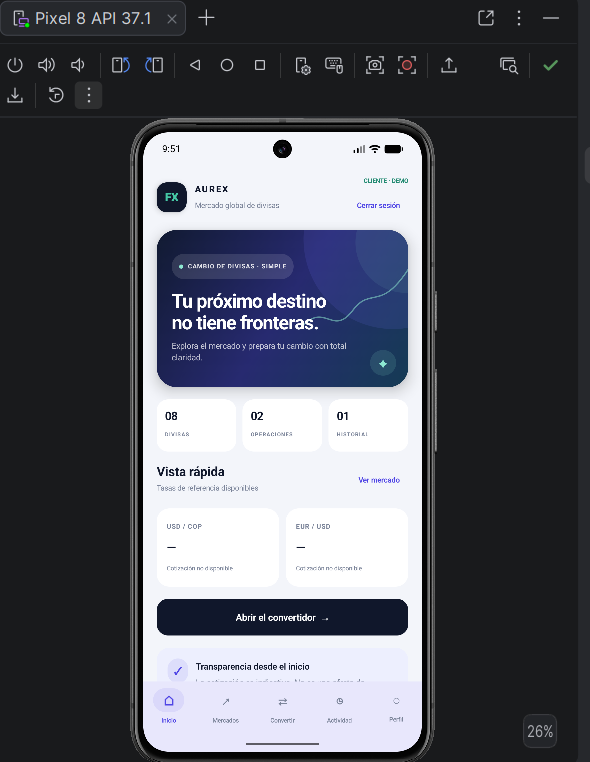
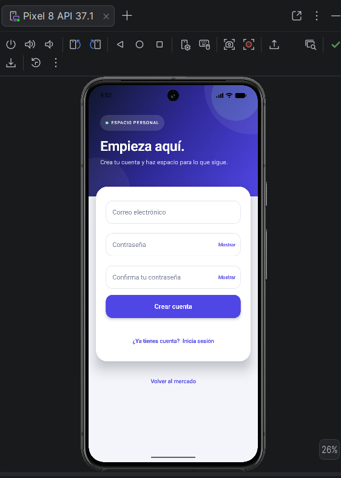
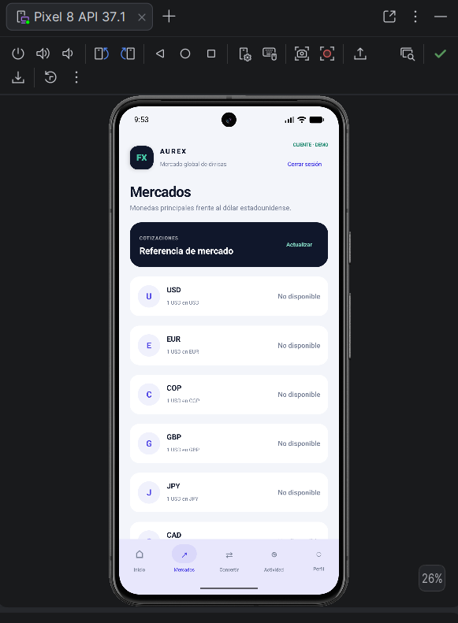
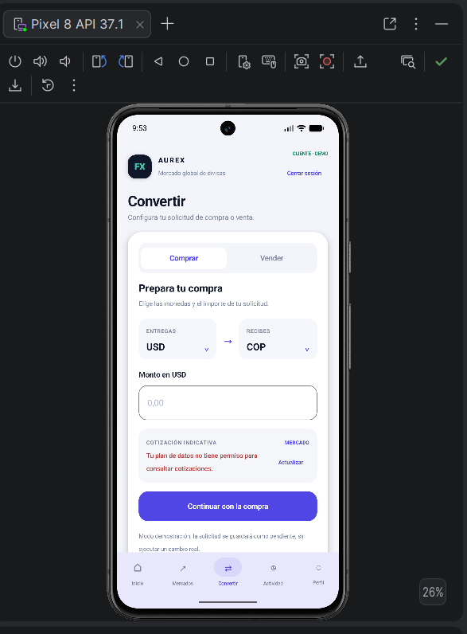
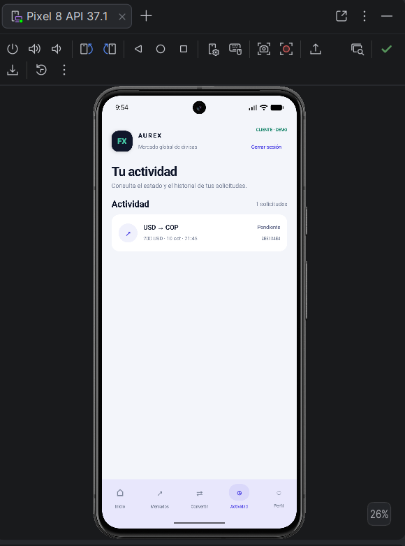
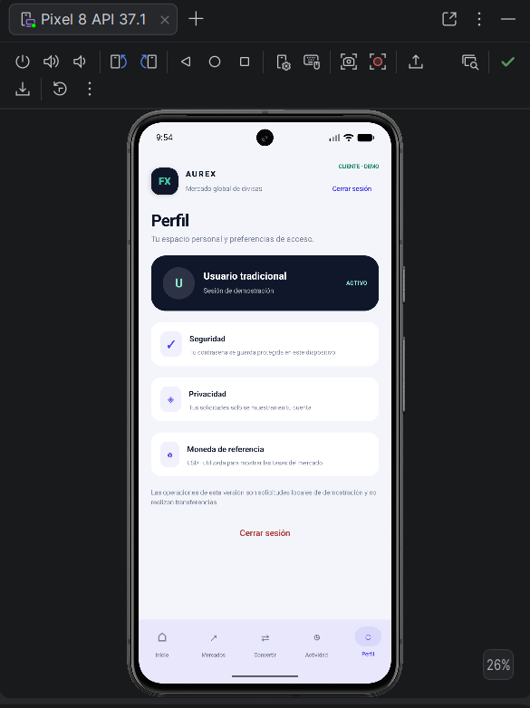

# AUREX — Mercado global de divisas

AUREX es una aplicación móvil para explorar cotizaciones de divisas, preparar solicitudes de compra y venta, consultar la actividad y administrar el acceso de la cuenta.

## Vistas de la aplicación

### 1. Inicio de sesión — Acceso y modo demostración

Permite entrar con una cuenta o explorar la aplicación como cliente o administrador en modo demo.

### 2. Inicio — Resumen del mercado

Presenta la bienvenida, un resumen visual, pares destacados y un acceso directo al convertidor.

### 3. Registro — Crear una cuenta

Formulario para crear una cuenta de usuario tradicional.

### 4. Mercados — Consulta de divisas

Muestra las monedas disponibles y sus tasas de referencia cuando el servicio de cotizaciones tiene acceso habilitado.

### 5. Convertir — Solicitud de compra o venta

Permite elegir la dirección del cambio, las monedas y el importe, y revisar la cotización indicativa antes de crear una solicitud.

### 6. Actividad — Historial de solicitudes

Permite consultar las solicitudes guardadas y revisar su estado.

### 7. Perfil — Cuenta y preferencias

Resume el tipo de sesión, la información de seguridad y privacidad, la moneda de referencia y las acciones de acceso.

## Capturas

Las imágenes de esta galería se encuentran en [`docs/screenshots`](docs/screenshots/).
